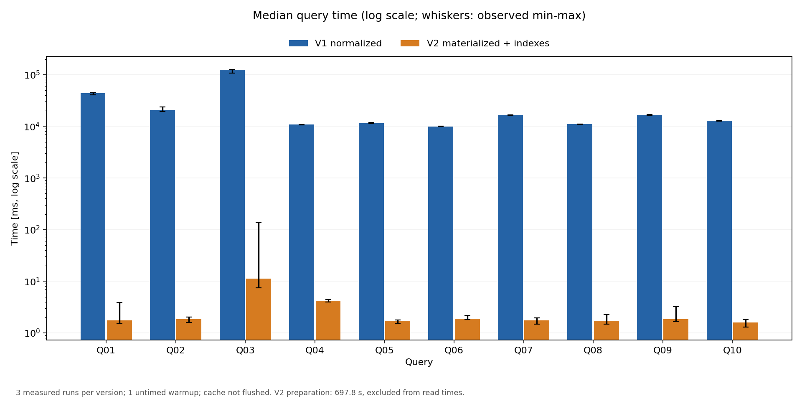

# MongoDB Restaurant Analytics

Analysis of **1,083,397 European restaurants** using MongoDB aggregation pipelines. The project answers ten questions about restaurant quality, dietary options, cuisines and potential market gaps.

It compares two ways of serving the same analytical queries:

- **V1:** four linked collections, joined and aggregated when a query runs.
- **V2:** four materialized collections containing city, cuisine and classification statistics, with compound indexes for filtering and ranking.

Python handles CSV import, collection builds, result validation and repeated measurements. The analytical logic runs in MongoDB.

## Stack

MongoDB, Python, PyMongo, pandas, Matplotlib and Metabase. Tests use Python's `unittest`, including integration tests against a real MongoDB server.

## Data and questions

Source: Stefano Leone's [TripAdvisor European restaurants](https://www.kaggle.com/datasets/stefanoleone992/tripadvisor-european-restaurants) dataset on Kaggle. The source lists **CC0: Public Domain**. Download and extract `tripadvisor_european_restaurants.csv` into `data/`; the CSV is not included in this repository.

The full input used here has 1,083,397 rows and 42 columns. The benchmark can record its SHA-256 to identify the exact file. This is a historical dataset, rather than a live view of restaurant availability.

| Query | Question |
| --- | --- |
| q01 | Which cities have the strongest highly rated vegetarian or vegan offering? |
| q02 | Which cities offer the most highly rated gluten-free restaurants? |
| q03 | Where do affordable lunch/dinner restaurants offer good value? |
| q04 | Where do expensive restaurants have a large food/service rating gap? |
| q05 | Which cuisines are well represented in major tourist cities? |
| q06 | Which highly rated cuisines have a smaller presence in those cities? |
| q07 | Which cities combine demand for quality with a small premium segment? |
| q08 | Which features occur most often among successful restaurants? |
| q09 | Which tags are most common among successful restaurants by price segment? |
| q10 | Which cuisines have the highest mean share of excellent reviews? |

These are descriptive comparisons. They do not establish that a feature causes success or predict whether an investment will be profitable.

## Run locally

Requirements: **Python 3.13** and a running **MongoDB 8.0** server. Run the following commands from the repository root. The pinned dependencies were tested with Python 3.13.

Windows PowerShell:

```powershell
python -m venv .venv
.\.venv\Scripts\python.exe -m pip install -r requirements.txt
Copy-Item .env.example .env
```

Edit `.env` for your MongoDB connection, database name and CSV location:

```dotenv
MONGODB_URI=mongodb://localhost:27017
MONGODB_DB=restaurant_analytics
CSV_PATH=data/tripadvisor_european_restaurants.csv
```

Choose an empty database for the initial import. Connection strings and raw data are ignored by Git.

```powershell
.\.venv\Scripts\python.exe src/import_v1.py
.\.venv\Scripts\python.exe src/build_v2.py
.\.venv\Scripts\python.exe src/benchmark.py --repetitions 3 --warmups 1 --dataset data/tripadvisor_european_restaurants.csv
.\.venv\Scripts\python.exe src/generate_performance_charts.py
```

The first import and build can take several minutes; repeating the V1 queries over the full dataset takes longer. For a quick import check, use `--limit 10000 --db restaurant_analytics_sample` with the importer and pass the same `--db` to subsequent commands. Some analytical queries may return no rows on a small sample because of their minimum group sizes.

The importer refuses to append to nonempty source collections. `import_v1.py --drop` explicitly replaces the four V1 collections. `build_v2.py --replace` rebuilds the four derived collections and preserves V1. **Rebuild V2 after any source change.** The build report is saved to `outputs/runs/build.json`.

On Linux/macOS, use `.venv/bin/python` in place of `.\.venv\Scripts\python.exe`, and `cp .env.example .env`.

## Validation and measurements

The benchmark compares both versions before publishing a timing ratio. Every paired run must return the same ordered rows, group identities, fields and values. Numeric comparisons tolerate floating-point differences of 1e-9. Ranking queries include deterministic tie-breakers before their top-k limit.

Each query version gets one untimed warmup followed by three measured executions. V1/V2 execution order alternates. Timings include consuming the result cursor; `explain("executionStats")` runs separately. The report stores all samples, medians, ranges, query pipeline hashes, index definitions and software versions.

Published artifacts are in [outputs/performance_charts](outputs/performance_charts). The CSV and compact JSON report accompany the charts.

In the recorded local run (MongoDB 8.0.23, Python 3.13.0, Windows), median V1 times ranged from **9.92 to 124.58 seconds**, and median V2 times from **1.59 to 11.19 milliseconds**. V2 preparation, including indexes, took **697.8 seconds**. Individual executions varied: q03's V2 samples ranged from 7.52 to 136.73 ms. The charts show observed ranges alongside medians.



**Interpretation:** these are local, warm-cache read measurements. V2 moves joins and aggregation work into a separate build, rather than obtaining the entire improvement from indexes. Build time, including index creation, is recorded separately. A read-only break-even estimate divides that cost by the saved time for one execution of every measured query.

V2 is a snapshot. There is no incremental refresh or atomic collection swap; do not rebuild while readers are using it. The benchmark assumes a static source. Matching collection counts are a guard against incomplete imports, not a guarantee that unchanged counts mean unchanged contents. Results are specific to this data, workload and machine.

To validate results without measuring repeated timings:

```powershell
.\.venv\Scripts\python.exe src/validate_results.py
```

To visualize the validated results or export them for Metabase:

```powershell
.\.venv\Scripts\python.exe src/generate_query_result_charts.py
.\.venv\Scripts\python.exe src/prepare_metabase_visualizations.py
```

The Metabase exporter creates `metabase_q01` through `metabase_q10`, a combined `metabase_query_results` collection and `metabase_performance`. It verifies that result files match the benchmark's checksums before writing. Use `--replace` to refresh an existing export. Original academic dashboard screenshots in `outputs/metabase charts/` are historical references; current exports use the validated benchmark results.

To inspect a single query and its execution plan:

```powershell
.\.venv\Scripts\python.exe src/v1_queries.py --query q08 --mode both --output-dir outputs/runs/v1
.\.venv\Scripts\python.exe src/v2_queries.py --query q08 --mode both --output-dir outputs/runs/v2
```

## Tests

Offline unit tests cover result comparison, explain counters and timing summaries. Integration tests create and clean up their own uniquely named database and check all ten query pairs, filtered averages, tie ordering, rebuild guards and repeated measurements.

```powershell
.\.venv\Scripts\python.exe -m unittest discover -s tests -v
$env:MONGODB_TEST_URI = "mongodb://localhost:27017"
.\.venv\Scripts\python.exe -m unittest discover -s tests -v
```

Integration tests are skipped when `MONGODB_TEST_URI` is unset. They require permission to create and drop their temporary test database.

## Repository guide

| Path | Purpose |
| --- | --- |
| `src/import_v1.py` | Chunked CSV import, missing-value handling and typed documents |
| `src/build_v2.py` | Aggregated read models, compound indexes and measured build cost |
| `src/v1_queries.py`, `src/v2_queries.py` | Ten paired aggregation pipelines and individual query runners |
| `src/validate_results.py` | Ordered result comparison and standalone validation |
| `src/benchmark.py` | Correctness-gated repeated timings and separate execution plans |
| `src/generate_performance_charts.py` | Charts and CSV from validated repeated measurements |
| `src/generate_query_result_charts.py` | Charts of validated analytical query results |
| `src/prepare_metabase_visualizations.py` | Optional result and timing collections for Metabase |
| `schema/` | Source and materialized data models |
| `queries/` | Generated pipelines in mongosh syntax |
| `tests/` | Unit and real-database integration tests |
| `outputs/runs/` | Ignored local build, validation and measurement files |

Regenerate the mongosh documents with `python src/generate_mongosh_queries_doc.py`. Query descriptions inside those documents retain the original Serbian wording.

